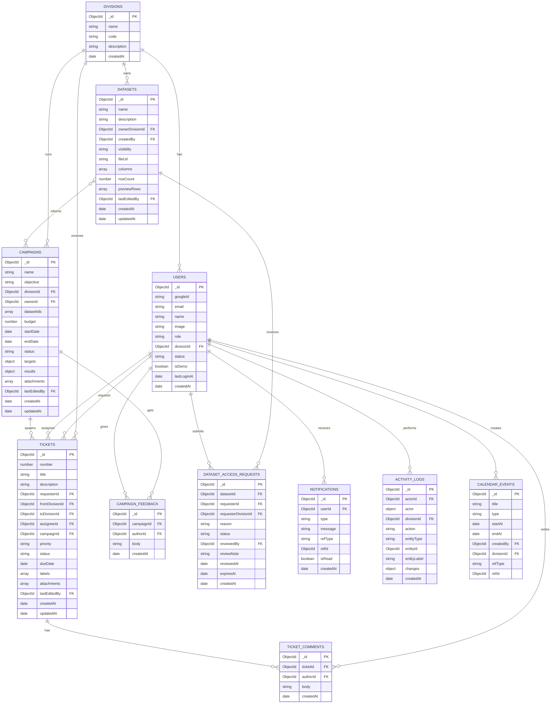

# Bagian B. ERD (MongoDB)

## 15. Prinsip Desain Data

- **Reference** untuk relasi antar objek utama (ObjectId), agar data tidak terduplikasi.
- **Embed** untuk data kecil yang selalu dibaca bersama induknya: lampiran pada tiket dan kampanye, snapshot nama pelaku pada activity log, dan pratinjau dataset.
- **Collection terpisah** untuk data yang tumbuh tanpa batas atau perlu real-time: komentar, feedback, notifikasi, dan activity log.
- Semua dokumen memiliki createdAt dan updatedAt; dokumen penting memiliki schemaVersion untuk memudahkan perubahan struktur di masa depan.
- Collection milik Auth.js (accounts, sessions, verification_tokens) dikelola oleh adapter dan tidak digambarkan di sini.

## 16. Diagram ERD

Diagram memakai sintaks Mermaid. Tempel ke mermaid.live untuk melihat gambarnya. Relasi menunjukkan reference; field bertipe object atau array adalah data yang di-embed.



## 17. Penjelasan Collection

| Collection              | Fungsi                                                                                               | Catatan embed                                                                                                        |
| ----------------------- | ---------------------------------------------------------------------------------------------------- | -------------------------------------------------------------------------------------------------------------------- |
| divisions               | Data divisi (Sales, Marketing, IT)                                                                   | Tidak ada                                                                                                            |
| users                   | Pengguna Google dan akun demo, dengan peran dan divisi                                               | status: pending, active, disabled                                                                                    |
| tickets                 | Request lintas divisi; fromDivisionId diambil dari divisi pembuat, toDivisionId adalah divisi tujuan | attachments (nama, url, pengunggah, waktu) dan labels di-embed                                                       |
| ticket_comments         | Diskusi pada tiket                                                                                   | Terpisah karena tumbuh tanpa batas dan perlu real-time                                                               |
| datasets                | Dataset yang dipublikasikan divisi                                                                   | columns (nama dan tipe kolom) dan previewRows (maks. sekitar 100 baris) di-embed; file penuh ada di penyimpanan file |
| dataset_access_requests | Permintaan akses beserta keputusan                                                                   | Satu dokumen per permintaan; expiresAt opsional                                                                      |
| campaigns               | Kampanye promo                                                                                       | targets, results, dan attachments di-embed; datasetIds adalah array reference                                        |
| campaign_feedback       | Masukan dari divisi lain                                                                             | Terpisah agar bisa real-time                                                                                         |
| calendar_events         | Jadwal promo, deployment, dan maintenance                                                            | refType dan refId opsional menaut ke objek terkait                                                                   |
| notifications           | Notifikasi per pengguna                                                                              | Index TTL untuk menghapus yang lama                                                                                  |
| activity_logs           | Jejak audit append-only                                                                              | actor di-embed sebagai snapshot (nama, divisi, peran) agar log tetap benar walau data pengguna berubah               |

## 18. Nilai yang Diizinkan (Enum)

| Field                          | Nilai                                                                                                         |
| ------------------------------ | ------------------------------------------------------------------------------------------------------------- |
| users.role                     | admin, manager, staff                                                                                         |
| users.status                   | pending, active, disabled                                                                                     |
| tickets.priority               | low, medium, high, urgent                                                                                     |
| tickets.status                 | open, in_review, in_progress, done, rejected                                                                  |
| datasets.visibility            | division, restricted, company                                                                                 |
| dataset_access_requests.status | pending, approved, rejected, revoked                                                                          |
| campaigns.status               | draft, review, active, finished                                                                               |
| calendar_events.type           | promo, deployment, maintenance, meeting                                                                       |
| activity_logs.action           | created, updated, status_changed, assigned, commented, approved, rejected, deleted                            |
| notifications.type             | ticket_created, ticket_assigned, ticket_status, comment, access_requested, access_reviewed, campaign_feedback |

## 19. Format Activity Log

Contoh dokumen untuk perubahan status tiket:

```json
{
  "actorId": "...",
  "actor": { "name": "Fajar", "divisionCode": "IT", "role": "staff" },
  "divisionId": "...",
  "action": "status_changed",
  "entityType": "ticket",
  "entityId": "...",
  "entityLabel": "#42 Landing page promo",
  "changes": { "status": { "from": "open", "to": "in_progress" } },
  "createdAt": "2026-10-19T09:30:00Z"
}
```

Setiap perubahan juga memperbarui lastEditedBy dan updatedAt pada dokumen yang diubah, sehingga label Last edited by tidak perlu membaca collection log.

## 20. Indeks yang Disarankan

| Collection              | Indeks                                               | Tujuan                                       |
| ----------------------- | ---------------------------------------------------- | -------------------------------------------- |
| users                   | email (unik), googleId                               | Login dan pencarian                          |
| tickets                 | {toDivisionId, status, createdAt desc}               | Antrian tiket per divisi                     |
| tickets                 | {assigneeId, status}                                 | Tiket milik seseorang                        |
| tickets                 | {requesterId}, {campaignId}                          | Tiket yang diajukan dan tiket per kampanye   |
| ticket_comments         | {ticketId, createdAt}                                | Memuat diskusi                               |
| datasets                | {ownerDivisionId, createdAt desc}                    | Daftar dataset per divisi                    |
| dataset_access_requests | {datasetId, requesterId, status}                     | Cek akses dan permintaan ganda               |
| campaigns               | {divisionId, status}                                 | Daftar kampanye                              |
| calendar_events         | {startAt, endAt}                                     | Kalender dan deteksi bentrok                 |
| notifications           | {userId, isRead, createdAt desc}; TTL pada createdAt | Notification center dan pembersihan otomatis |
| activity_logs           | {entityType, entityId, createdAt desc}               | Riwayat per objek                            |
| activity_logs           | {divisionId, createdAt desc}                         | Activity feed per divisi                     |

## 21. Catatan Migrasi dari ERD Relasional

- Tabel attachments dihapus; lampiran menjadi array yang di-embed pada tiket dan kampanye.
- Tabel divisions tetap ada sebagai data, bukan hardcode, sehingga menambah divisi baru tidak memerlukan perubahan kode.
- Karena single company, tidak ada collection organizations. Bila suatu hari dibutuhkan, tambahkan organizationId pada semua collection utama.
- Tidak ada migrasi skema otomatis seperti di database relasional; gunakan schemaVersion dan skrip migrasi sederhana bila struktur berubah.
